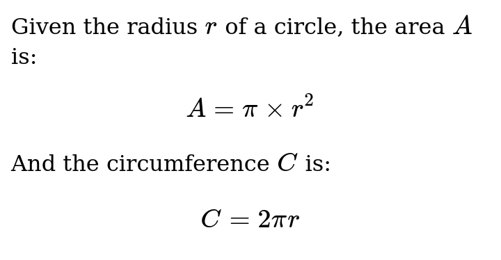

# Goldmark Katex

[](https://pkg.go.dev/github.com/FurqanSoftware/goldmark-katex)

Goldmark Katex is a [Goldmark](https://github.com/yuin/goldmark) extension providing math and equation support through [KaTeX](https://katex.org/).

## Usage

``` go
// Default, errors are highlighted in red in the output
goldmark.New(goldmark.WithExtensions(&katex.Extender{})).Convert(src, dst)

// With ThrowOnError set to true
goldmark.New(goldmark.WithExtensions(&katex.Extender{
    ThrowOnError: true,
})).Convert(src, dst)
```

Wrap inline math with a pair of single `$`:

```markdown
$A$
```

Wrap block math with a pair of double `$`:

```markdown
$$
A = \pi \times r^2
$$
```

A `$$` that begins a line opens a block, which runs to the next `$$` or to the
end of the document, much as a fenced code block does. The equation is parsed
before Markdown, so it is kept verbatim however long it is, and delimiters may
hug it:

```markdown
$$\begin{aligned}
a &= b \\
c &= d
\end{aligned}$$
```

Double `$` in the middle of a line is display math too, rendered in place within
the surrounding paragraph:

```markdown
Einstein wrote $$E = mc^2$$ in 1905.
```

## Example

<table>
<tr>
<td>

```markdown
Given the radius $r$ of a circle, the area $A$ is:

$$
A = \pi \times r^2
$$

And the circumference $C$ is:

$$
C = 2 \pi r
$$
```

</td>
<td>



</td>
</tr>
</table>

## More Goldmark Extensions

- [D2](https://github.com/FurqanSoftware/goldmark-d2): diagram support through [D2](https://d2lang.com/)
